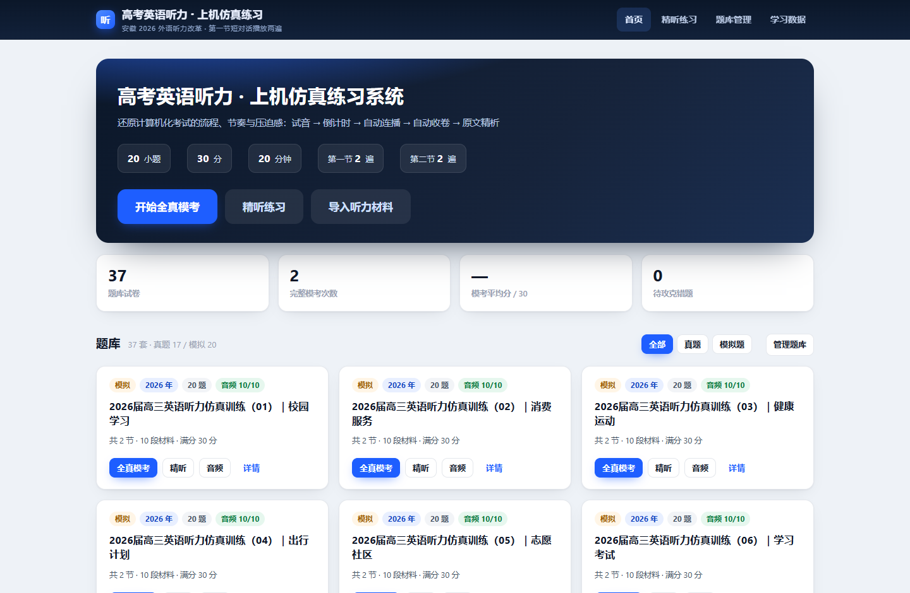
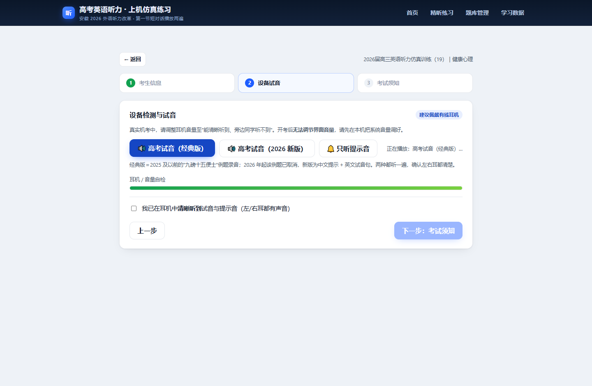
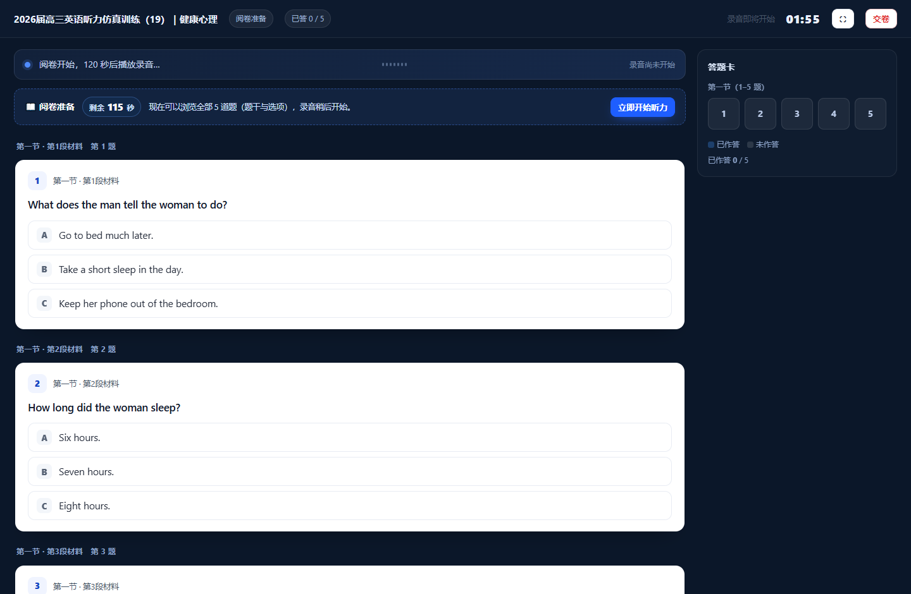
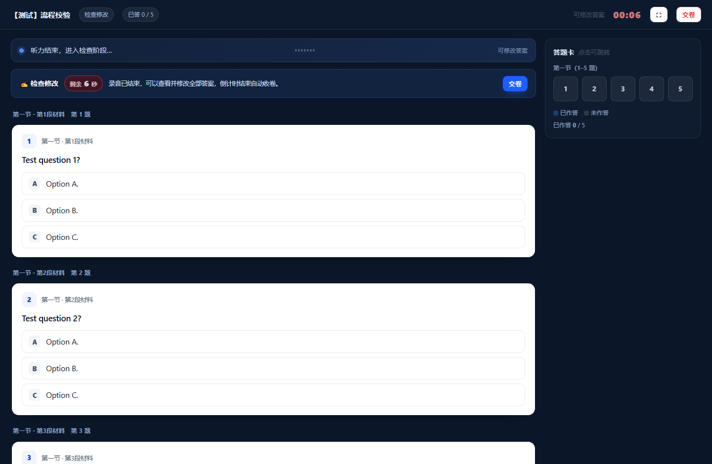
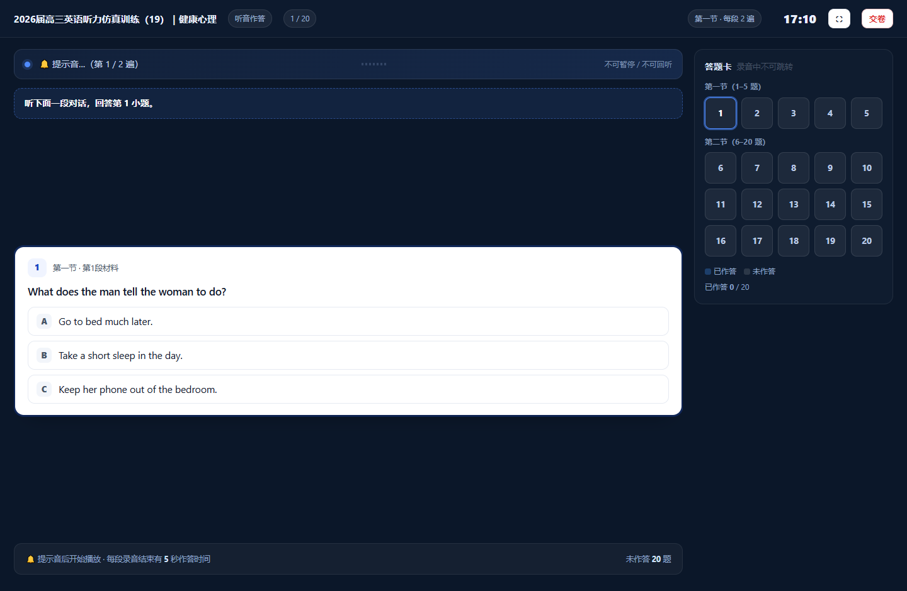
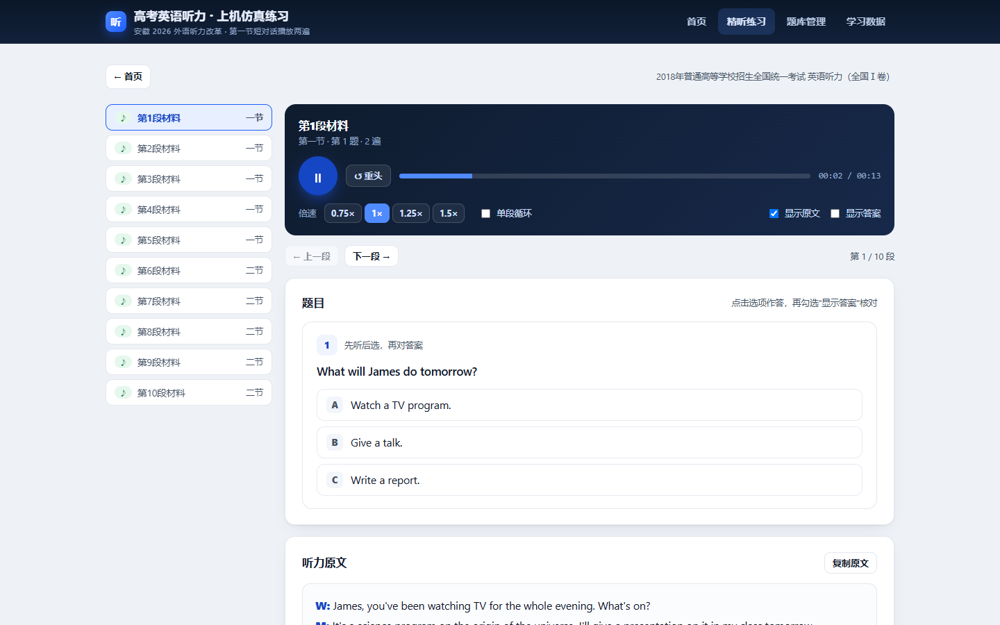
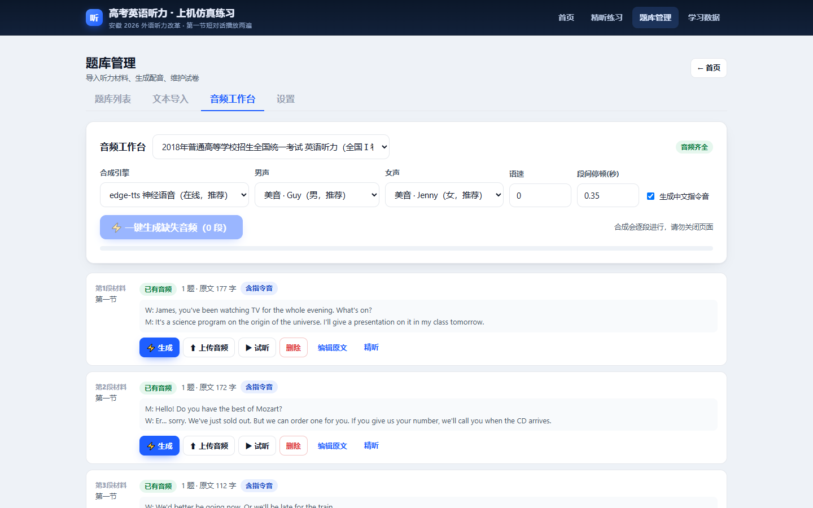
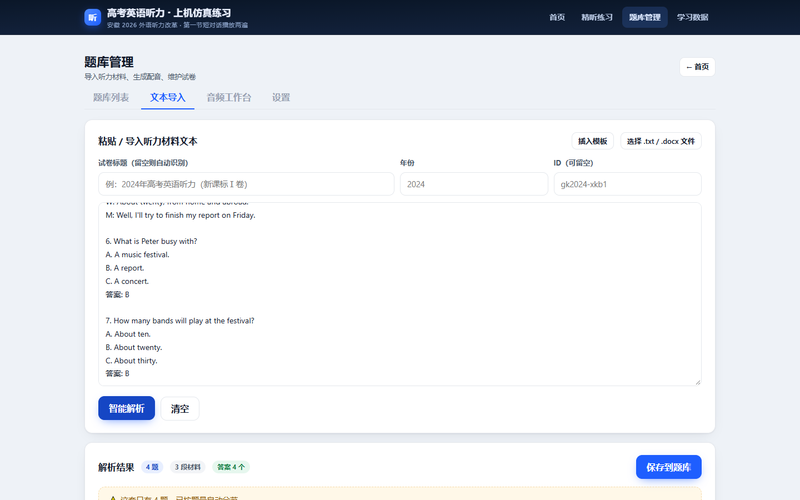
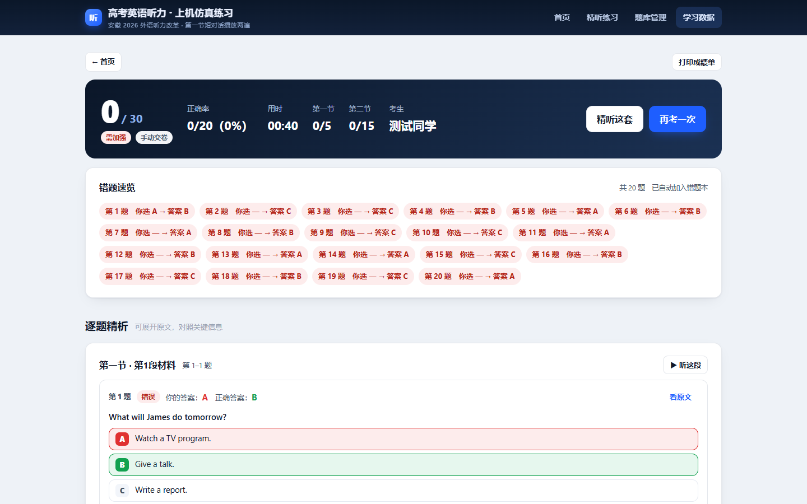

# 高考英语听力 · 上机仿真练习系统

> Gaokao English Listening · Computer-based Test Simulator
>
> 一个开在自己电脑上的听力机考练习软件：**37 套题库（17 套真题 + 20 套模拟）+ 740 段音频**，
> 把纸质听力书粘进来就能变成机考题；没录音还能用 AI 配音。
> 本地运行、零依赖、全离线，Windows 双击 `启动系统.bat` 即可。

面向 **安徽省 2026 年起外语听力计算机化考试（机考）** 的本地练习软件：还原机考流程与节奏，
内置 **37 套听力题（17 套高考真题 2018—2026 + 20 套仿真模拟题）**，并支持把纸质听力书的文本一键变成可考的机考题。

- 20 小题 / 30 分 / 约 20 分钟
- 第一节 5 段短对话、第二节 5 段长对话或独白，**每段录音都播放两遍**（2026 改革新规）
- 试音 → 倒计时 → 自动连播（不能暂停、不能回听）→ 自动收卷 → 成绩报告 + 原文精析
- 没有音频也能练：粘贴原文即可用神经网络语音自动生成男女声对话



## 📥 下载与安装（三步，转给同学看）

> **第 1 步 · 下载**　打开 **[Releases 页面](https://github.com/DHR660/gk-listening/releases/latest)** → 点 `Source code (zip)` 下载（约 95 MB，含全部音频）→ 解压到任意文件夹，例如 `D:\gk-listening`。
> 也可以在仓库页点绿色 `Code` → `Download ZIP`，效果一样。
>
> **第 2 步 · 装 Node.js（只装一次）**　到 <https://nodejs.org/zh-cn> 下载 **LTS** 版，一路"下一步"（保持默认勾选 `Add to PATH`）。
>
> **第 3 步 · 双击 `启动系统.bat`**　会弹出一个黑色窗口（本地服务，**别关它**），浏览器自动打开 `http://127.0.0.1:8765/`，看到题库列表就成功了。

解压后应该能看到这些：`启动系统.bat`、`server.js`、`web/`、`data/`、`tools/`。
如果只解压出两层同名文件夹，进到里层再双击。

**可选**：双击 `安装语音合成.bat`（需 Python 3），把任意英文原文自动配成男女声对话。
**只看说明**：不解压也能先看 **[使用手册.html](使用手册.html)**（单文件，图片全内嵌）。

**新手常见问题**

| 现象 | 处理 |
|---|---|
| 浏览器没自动打开 | 手动访问 `http://127.0.0.1:8765/` |
| 提示"未检测到 Node.js" | 装完 Node.js 后重开一次窗口；确认安装时勾了 `Add to PATH` |
| 双击 bat 一闪而过 | 右键 → 以管理员身份运行；或在地址栏输入 `cmd` 回车后输入 `启动系统.bat` 看报错 |
| Windows 提示"已保护你的电脑" | 点"更多信息 → 仍要运行"（脚本没做数字签名很正常） |
| 端口 8765 被占用 | 关掉另一个正在跑的窗口；或右键 bat 编辑，把 `set PORT=8766` 打开 |
| 想更新版本 | 重新下载 ZIP 覆盖，保留 `data/sets` 与 `data/audio` 即可 |

> 如果你拿到的是**便携版**（文件夹里有 `runtime\node.exe`），**不用装 Node.js**，直接双击 bat。
> 关掉那个黑色窗口 = 停止服务；题库、音频、成绩都在这个文件夹里，整个目录拷到别的电脑（装好 Node）就能继续用。

---

> **新手先看**：面向用户、图文并茂的 **[使用手册.md](使用手册.md)**（同目录还有可直接双击打开的 **[使用手册.html](使用手册.html)**，单文件、图片已内嵌）。
> 改完手册内容后可运行 `py tools\md2html.py` 重新生成 HTML。

**开源信息**

- 代码协议：**MIT**（见 [LICENSE](LICENSE)）；真题文字与合成音频的权利说明见 **[NOTICE.md](NOTICE.md)**；
- 想自己部署一份/二次开发：见 **[CONTRIBUTING.md](CONTRIBUTING.md)**；
- 仓库约 **95 MB**，主要是 `data/audio/` 里的 740 段音频（开箱即用）。嫌大可以删掉该目录，
  运行 `py tools\build_audio.py` 用原文重新生成；
- 已经在本地提交好 git 历史，推送到 GitHub 的步骤见 **[开源指南.md](开源指南.md)**。

---

## 一、30 秒启动

1. 安装 [Node.js](https://nodejs.org/zh-cn)（18 及以上，**只需装一次**）。
2. 双击 **`启动系统.bat`** —— 浏览器会自动打开 <http://127.0.0.1:8765/>。
3. （可选，推荐）双击 **`安装语音合成.bat`**，安装 `edge-tts`。
   装好后可以在软件里把任何英文原文自动配成男女声对话；不装也能用已内置的音频，或自己上传 MP3。

> 关掉那个黑色命令行窗口 = 停止服务。题库、音频、成绩都存在本文件夹里，整个目录可以拷到任何一台装了 Node.js 的电脑上继续用。

---

## 二、三种练习方式

### 1）全真模考 —— 和真实机考同一套流程

| 环节 | 真实机考 | 本系统 |
|---|---|---|
| 考生信息 | 输入姓名 / 考号 | ✅ 姓名、准考证号（成绩单上显示） |
| 设备试音 | 耳机里放高考试音，自己调音量 | ✅ **高考试音（经典版"九磅十五便士" / 2026 新版）**，另外可单独试听提示音、自检音量 |
| 考试须知 | 阅读规则后进入 | ✅ 勾选"已阅读"才能开考 |
| 阅卷 | 开考前可先看试卷 | ✅ **开考前 2 分钟**浏览全部 20 题（只看不能答，页面有醒目倒计时，可提前开始） |
| 开始 | 倒计时后统一开考 | ✅ 3-2-1 倒计时 + 提示音 |
| 提示音 | 每一遍录音开始前有一声"叮咚"铃 | ✅ 先播中文指令，**每一遍录音前**都响 `_cue.wav`（第一遍、第二遍都响） |
| 播放规则 | 第一节 2 遍、第二节 2 遍，段间有指令与停顿 | ✅ 完全一致（可切换成旧卷"第一节 1 遍"） |
| 中文指令 | "听下面一段对话，回答第 6 至第 7 小题" | ✅ 有语音（生成配音时自动带）+ 屏幕文字 |
| 听前读题 | 每题 5 秒读题干与选项 | ✅ 每段前按题数给 5 秒：第一节 5 秒，第二节 2–4 题 = 10–20 秒 |
| 播放进度 | 不显示进度，防止按时间猜答案 | ✅ **播放条改为波浪动画**，只表示"正在播放"，看不到位置与剩余 |
| 看题范围 | 只看当前这段材料 | ✅ 录音期间只显示本段题目，下一段开始自动跳过去 |
| 每段作答 | 录音结束留 5 秒作答 | ✅ 每段录音结束**共 5 秒**（可在设置里调） |
| 检查修改 | 交卷前可回看 | ✅ 录音结束后给 **2 分钟**改全部答案（有醒目倒计时），倒计时到自动收卷 |
| 暂停/回听 | 不允许 | ✅ 不提供（播放条只读） |
| 成绩 | 只有分数 | ✅ 分数 + 正确率 + 分节得分 + 逐题原文 + 错题本 |

其他细节：全屏作答、离开页面计数（成绩单上显示）、右键/刷新提醒；听音阶段答题卡锁定（防跳题），检查阶段可点答题卡跳转。

> **关于时长**：倒计时不是写死的 20 分钟，而是按「阅卷 2 分钟 + 实际音频长度 + 检查 2 分钟」自动算。
> 用现在内置的合成音频，一整套 **18–22 分钟**（平均听力 16 分 02 秒 + 阅卷 2 分 + 检查 2 分）；
> 官方录音停顿更长、听力本身约 20 分钟，把音频换成官方 MP3 后倒计时会自动变长，与真实机考一致。
> 阅卷 / 检查 / 每段作答时间都能在「题库管理 → 设置」里改。










### 2）精听练习

逐段播放、倍速（0.75×–1.5×）、单段循环、拖动定位、显示/隐藏原文、显示答案。
适合模考之后回到原地，把没听清的段落反复磨。



### 3）题库管理

- **题库列表**：查看每套试卷的音频完整度，重命名、导出 JSON、删除，支持搜索
- **文本导入**：粘贴 / 导入 `.txt` `.docx` → 智能解析成"节—材料—题目—选项—答案—原文"
- **音频工作台**：每段材料可"一键生成配音"或"上传音频"，支持批量补齐
- **设置**：字号、是否显示对错、默认播放遍数、**阅卷 / 检查 / 每段作答时间**、**提示音开关**



---

## 三、内置题库（37 套：真题 17 + 模拟题 20）

首页题库区可以按「全部 / 真题 / 模拟题」筛选，题库管理页支持搜索。
逐套的答案、来源链接与备注见 **[题库清单.md](题库清单.md)**。

### 1）真题 17 套（2018—2026）

| 年份 | 卷别 | 文件 |
|---|---|---|
| 2026 | 浙江首考（教育部命题，第一节已改两遍） | `gk2026-zj.json` |
| 2025 | 新课标Ⅰ卷 / 新课标Ⅱ卷 | `gk2025-xkb1` / `gk2025-xkb2` |
| 2024 | 全国甲卷 / 新课标Ⅰ卷 / 新课标Ⅱ卷 | `gk2024-jia` / `gk2024-xkb1` / `gk2024-xkb2` |
| 2023 | 全国乙卷 / 新课标Ⅰ卷 | `gk2023-yi` / `gk2023-xkb1` |
| 2022 | 全国甲卷 | `gk2022-jia` |
| 2021 | 全国甲卷 / 新高考Ⅰ卷 | `gk2021-jia` / `gk2021-xgk1` |
| 2020 | 全国Ⅰ卷 / 新高考Ⅰ卷（山东） | `gk2020-n1` / `gk2020-xgk1` |
| 2019 | 全国Ⅰ卷 / 全国Ⅱ卷 | `gk2019-n1` / `gk2019-n2` |
| 2018 | 全国Ⅰ卷 / 全国Ⅱ卷 | `gk2018-n1` / `gk2018-n2` |

### 2）仿真模拟题 20 套（按 2026 题型原创）

| 编号 | 主题 | 文件 |
|---|---|---|
| 01 | 校园学习 | `mock2026-01` |
| 02 | 消费服务 | `mock2026-02` |
| 03 | 健康运动 | `mock2026-03` |
| 04 | 出行计划 | `mock2026-04` |
| 05 | 志愿社区 | `mock2026-05` |
| 06 | 学习考试 | `mock2026-06` |
| 07 | 工作求职 | `mock2026-07` |
| 08 | 科技网络 | `mock2026-08` |
| 09 | 家庭邻里 | `mock2026-09` |
| 10 | 文化艺术 | `mock2026-10` |
| 11 | 校园开放日 | `mock2026-11` |
| 12 | 城市骑行 | `mock2026-12` |
| 13 | 社区志愿 | `mock2026-13` |
| 14 | 体育健身 | `mock2026-14` |
| 15 | 餐饮外卖 | `mock2026-15` |
| 16 | 科技与 AI | `mock2026-16` |
| 17 | 环境保护 | `mock2026-17` |
| 18 | 传统文化 | `mock2026-18` |
| 19 | 健康心理 | `mock2026-19` |
| 20 | 职业体验 | `mock2026-20` |

说明：

- 每套都是 **20 题 + 完整英文听力原文 + 答案 + A/B/C 选项**，音频按"每段材料一个文件"存放。
- **模拟题是按 2026 高考听力题型原创编写**（第一节 5 段短对话各 1 题；第二节 5 段材料 2/3/3/4/3 题，末段为独白），
  每套 918–950 词，难度、语速、题型分布按真题校准；标题里的"合肥一模 / 江淮十校 / 百校联考"等只是**风格参考**，
  内容为原创，不是真实试卷。
- **音频已全部生成完毕**：37 套 ×（10 段材料音 + 10 段中文指令音）= 740 个 MP3（约 85 MB），
  打开即可直接模考，不需要再等合成。
- 音频是 **edge-tts 神经语音按原文合成**（男女声分角色朗读，非官方真人录音）。语速、停顿与真题接近，
  但仍建议条件允许时换成官方 MP3：把音频按段切开，在「音频工作台 → 上传音频」逐段替换即可，效果最好。
- 同题异卷已合并（2018 Ⅱ/Ⅲ 卷、2019 Ⅱ/Ⅲ 卷、2020 Ⅰ/Ⅱ/Ⅲ 卷、2021 甲/乙 卷当年共用一套听力）。

---

## 四、把纸质听力书变成机考题

### 第一步：把文本弄进来

- 直接**粘贴**（从 PDF、Word、网页复制的文字都行）
- 或点「选择 .txt / .docx 文件」，系统会自动把 Word 正文抽出来（无需 Office）

### 第二步：点「智能解析」

两种排版都能识别：

**A. 讲义式（推荐，最稳）**

```
# 标题: 2026届高三英语听力强化训练（三）
第一节
Text 1
W: Good morning. Can I help you?
M: Yes, I'd like to return this jacket.
1. What does the man want to do?
A. Buy a jacket.
B. Return a jacket.
C. Try on a jacket.
答案: B
```

**B. 试卷式（和真卷一样的排法）**

前半部分是 1–20 题（题干 + A/B/C 选项），末尾写「听力原文」，下面依次 `Text 1 … Text 10`。
系统会自动把 20 题分成"第一节 5 段短对话 + 第二节 5 段长对话/独白（2/2/3/4/4 题）"。

解析规则：

| 内容 | 支持写法 |
|---|---|
| 材料分隔 | `Text 1` `Conversation 1` `材料1` `第1段` `听力材料 1` |
| 题号 | `1.` `1、` `1)` |
| 选项 | 一行一个 `A. …`，或一行并列 `A. … B. … C. …` |
| 答案 | 逐题 `答案：B`、成对 `1.B 2.C`、区段 `1-5 BCACA` |
| 原文区 | `听力原文` / `录音原文` / `Tapescript` |
| 说话人 | `M:` `W:` `Man:` `Woman:`（用于男女声分角色配音） |

解析完会显示统计与警告（缺答案、缺原文、分组是否正确），还可以展开 **JSON 微调** 手动改任何细节。

### 第三步：补音频

进入「音频工作台」：

- **⚡ 一键生成缺失音频**：按原文合成（在线神经语音，约 5–15 秒/段）
- **⬆ 上传音频**：听力书配套 MP3（每段一个文件），音质最佳
- **编辑原文**：改错别字、补漏句，然后重新生成
- 勾选"生成中文指令音"后，每段开头会有"听下面一段对话，回答第 6 至第 7 小题"的提示音，和真考一样



---

## 五、成绩单与数据

- 每场模考自动保存：分数、正确率、分节得分、用时、离开页面次数、逐题对错
- 错题自动进入**错题本**（跨试卷累计错误次数，可一键跳到对应材料精听）
- 成绩曲线、"学习数据"页可查看/删除记录、打印成绩单
- 数据位置：
  - 题库 `data/sets/*.json`（UTF-8）
  - 音频 `data/audio/<试卷id>/<材料id>.mp3`（中文指令音为 `<材料id>.prompt.mp3`）
  - 成绩 `data/records.json`，本地误删也可以在"学习数据"里清空重来
- 备份：直接复制整个 `gk-listening` 文件夹；题库列表页也有「导出全部 / 导入 JSON」



---

## 六、批量生成音频（命令行）

已经内置好 37 套的音频。如果你自己导入了新试卷，除了在网页里点按钮，也可以命令行批量跑：

```bat
py tools\build_audio.py                :: 全部试卷，缺什么补什么（断点续传）
py tools\build_audio.py gk2026-zj      :: 只做某一套
py tools\build_audio.py --jobs=8       :: 并发数
py tools\build_audio.py --force        :: 全部重新生成
py tools\build_audio.py --rate=-5      :: 整体放慢 5%（更接近真人朗读的真题语速）
```

只用 Windows 自带语音（离线、质量一般）：

```bat
py tools\tts.py --engine sapi --text-file 原文.txt --out 输出.wav
```

重新生成考试提示音与高考试音：

```bat
py tools\make_cue.py          :: 每一遍录音前的"叮咚"铃声（默认 1.55 秒）
py tools\make_test_audio.py   :: 高考试音：_test_classic.mp3（经典版）/ _test_2026.mp3（2026 新版）
```

---

## 七、常见问题

**Q：打开 bat 提示"未检测到 Node.js"？**
装 Node.js（LTS 版）后重新双击。只装一次。

**Q：一键生成音频一直失败？**
需要联网（edge-tts 走微软在线语音）。网络不稳时改用「Windows 本地语音」，或直接上传 MP3。

**Q：真题音频和官方录音不一样？**
内置音频是按公开原文用神经语音合成的。想要原汁原味，用听力书/真题配套 MP3 逐段上传替换。

**Q：手机上能练吗？**
可以。服务启动后，命令行窗口会打印一个"局域网"地址（如 `http://192.168.1.5:8765/`），
手机连同一 WiFi 打开即可（手机浏览器也能作答，但推荐电脑，机考本来就是在电脑上）。

**Q：第一节到底播几遍？**
2026 年起第一节短对话 **播两遍**（以前是一遍）。本系统默认 2 遍；在「考生信息」页可以把第一节切回 1 遍，
用于按旧卷原样练 2025 年及以前的真题。

**Q：能改题目/答案吗？**
能。题库列表 → 重命名；文本导入的预览里有 JSON 微调；音频工作台可编辑每段原文。
JSON 就在 `data/sets/` 里，结构见下。

---

## 八、题目 JSON 结构

```json
{
  "id": "gk2024-xkb1",
  "title": "2024年普通高等学校招生全国统一考试 英语听力（新课标Ⅰ卷）",
  "exam": "新课标Ⅰ卷",
  "year": 2024,
  "durationSec": 1200,
  "scorePerQuestion": 1.5,
  "sections": [
    {
      "id": "sec1", "name": "第一节", "plays": 2,
      "desc": "听下面5段对话……",
      "materials": [
        { "id": "m1", "label": "第1段材料",
          "transcript": "W: ...\nM: ...",
          "questions": [
            { "no": 1, "text": "What will James do tomorrow?",
              "options": { "A": "Watch a TV program.", "B": "Give a talk.", "C": "Write a report." },
              "answer": "B" }
          ] }
      ]
    }
  ]
}
```

`materials[].audio` / `.hasAudio` / `.promptAudio` 由服务端根据 `data/audio/` 里的文件自动补全，不用手写。

---

## 九、目录结构

```
gk-listening/
├── 启动系统.bat            双击启动（会自动开浏览器）
├── 安装语音合成.bat        安装 edge-tts（可选）
├── server.js               本地服务（零依赖 Node.js）
├── README.md
├── web/                    前端
│   ├── index.html
│   ├── css/app.css
│   └── js/  util / parser / main / home / exam / report / practice / bank / history
├── data/
│   ├── sets/               题库（37 套 JSON：真题 17 + 模拟 20）
│   ├── audio/<试卷id>/     每段材料的 mp3 + 中文指令音
│   └── records.json        练习记录
├── tools/
│   ├── tts.py              语音合成（edge-tts / Windows SAPI，自动分角色、自动拼静音）
│   ├── make_cue.py         生成考试提示音（"叮咚"铃声 → data/audio/_cue.wav）
│   ├── make_test_audio.py  生成高考试音（经典版"九磅十五便士" / 2026 新版）
│   ├── build_audio.py      批量生成音频（断点续传）
│   ├── validate_sets.js    题库结构校验（node tools/validate_sets.js）
│   ├── gen_manifest.js     重新生成「题库清单.md」
│   ├── md2html.py          把 使用手册.md 转成单文件 HTML（图片内嵌）
│   └── test_parser.js      文本解析器单元测试（node tools/test_parser.js）
├── 题库清单.md             37 套的答案串、来源与备注
├── 使用手册.md             面向用户的功能介绍（图文）
├── 使用手册.html           同一份手册的单文件网页版（图片内嵌，双击即看）
├── 安装说明.md             给同学看的安装步骤（Releases 下载 → 解压 → 装 Node → 双击启动）
├── LICENSE                 MIT 协议（代码）
├── NOTICE.md               真题文字 / 合成音频 / 试音材料的权利说明
├── CONTRIBUTING.md         贡献指南（提交前自检、内容边界）
├── 开源指南.md             把本项目推到自己 GitHub 的步骤
└── docs/                   截图
```

---

## 十、政策依据

- 安徽省教育厅厅长信箱回复（2026 年高考英语听力形式）：<https://jyt.ah.gov.cn/content/article/40781422>
- 安徽日报教育融：《安徽省 2026 年高考英语大调整》——英语等六个外语科目听力第一节 5 题由播放一遍改为两遍，
  优化听力内容，总时长仍约 20 分钟：<http://xxt.ahnews.com.cn/news/2025/12/17/c_43633.htm>
- 2026 听力首考复盘（题型结构、语速提升至约 143 词/分、机考省份情况）：
  <http://www.163.com/dy/article/KMPQRILN05568KXJ_pdya11y.html>

> 安徽：2026 年 3 月首考仍为纸笔形式，2026 年 5 月起组织机考试点，**2027 年起全面机考**。
> 本系统的流程按机考设计，现在练、明年用正合适。

---

## 十一、版权与免责

- 题库文本来自公开网络上的高考听力真题资料（题干、选项、答案、听力原文），仅供个人学习练习使用，请勿用于商业用途。
- 内置音频由 `edge-tts` 依据原文合成，与官方录音无关。
- 软件只在本机运行，不联网上传任何数据（除语音合成需访问微软语音服务）。

---

## 十二、开源协议与贡献

- **代码**：[MIT](LICENSE)，可自由使用、修改、再分发（保留版权声明）。
- **内容**：真题文字、合成音频的权利归属与使用边界见 **[NOTICE.md](NOTICE.md)**；模拟题为原创，随代码一并以 MIT 开放。
- **贡献**：欢迎 Issue / PR，提交前请跑 `node tools\validate_sets.js` 与 `node tools\test_parser.js`，
  细节见 **[CONTRIBUTING.md](CONTRIBUTING.md)**。
- **部署到自己的 GitHub**：见 **[开源指南.md](开源指南.md)**（gh CLI 一条命令，或纯 git 两步）。

如果这个项目帮你省下了找听力音频、拼听力书的时间，给个 ⭐ 就是最好的支持。

