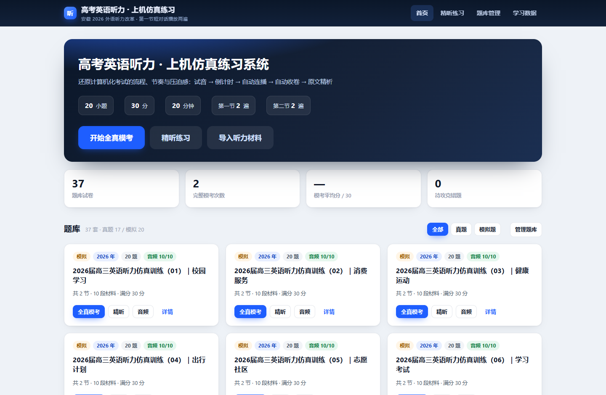
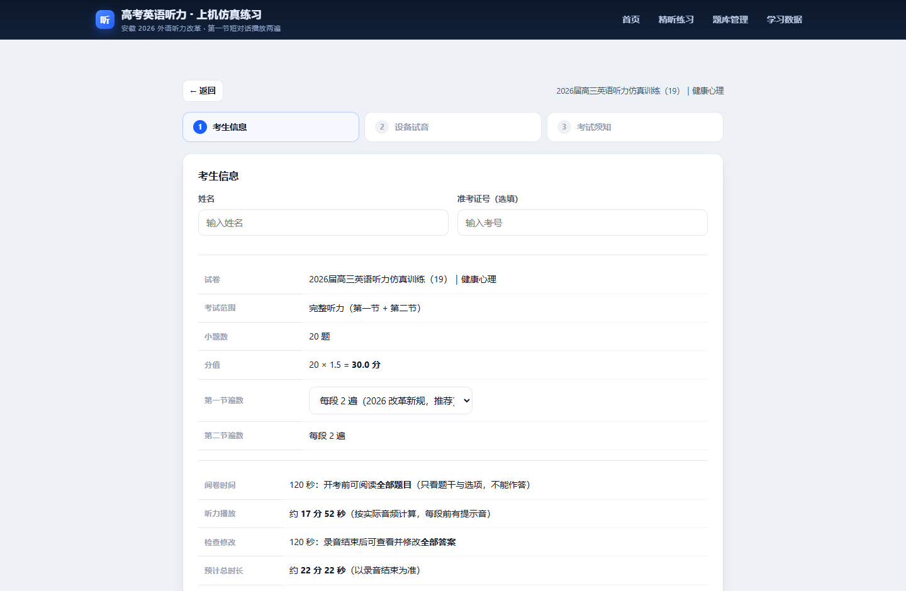
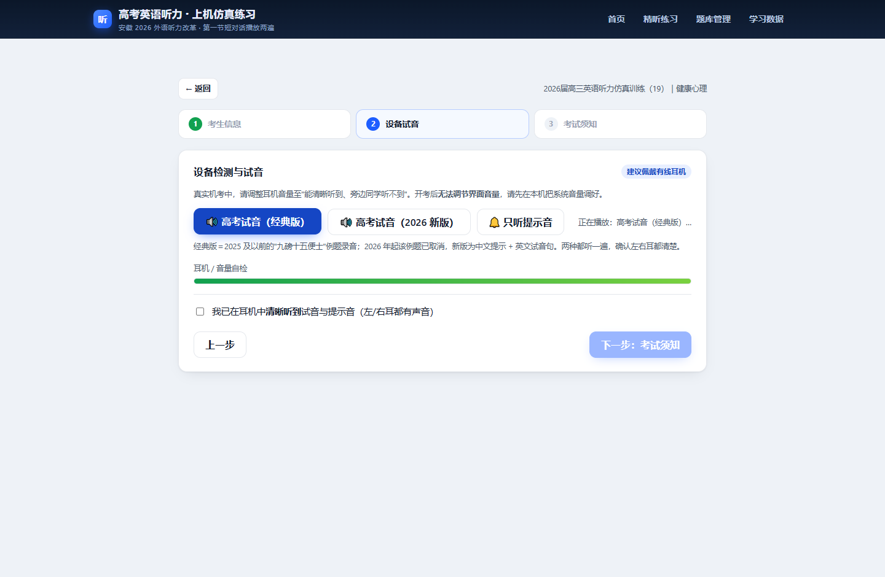
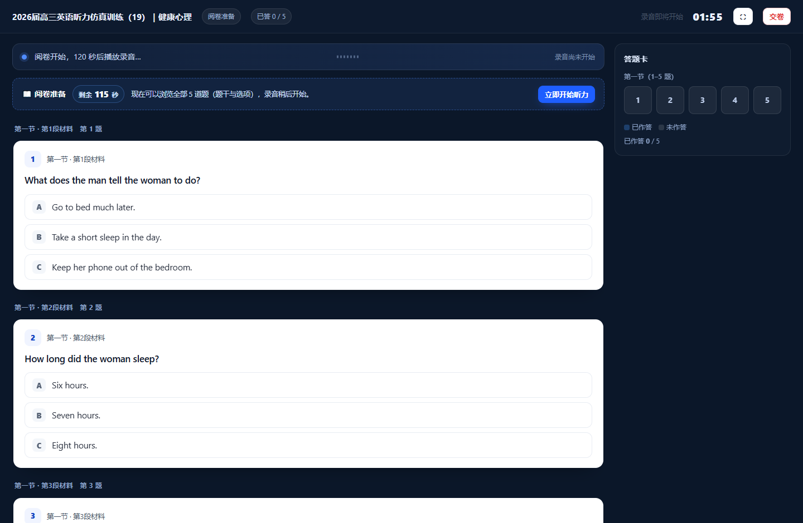
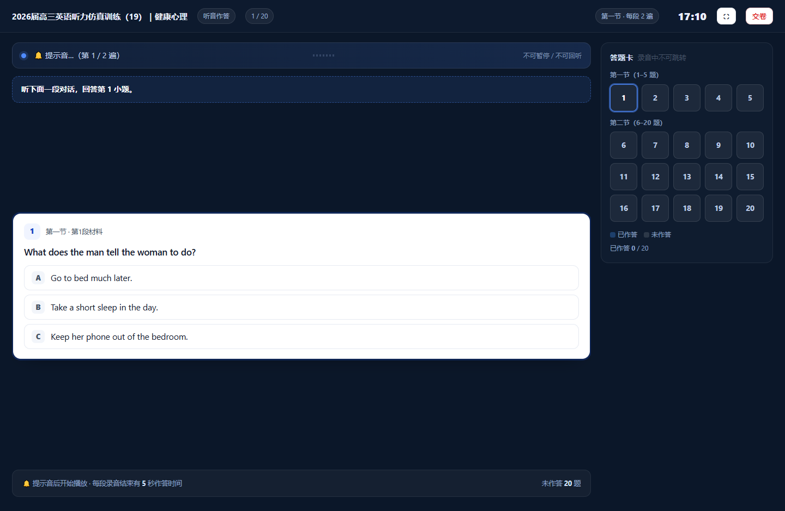
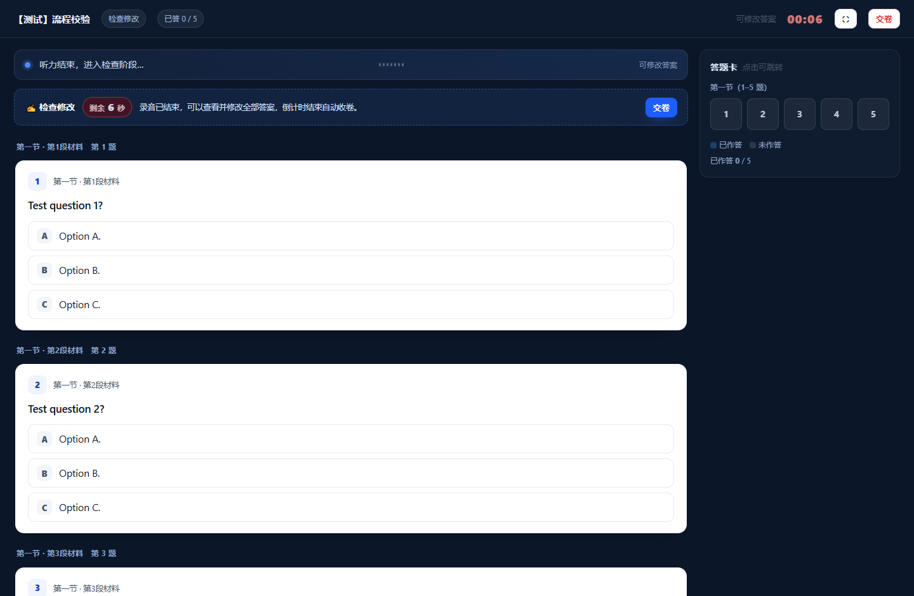
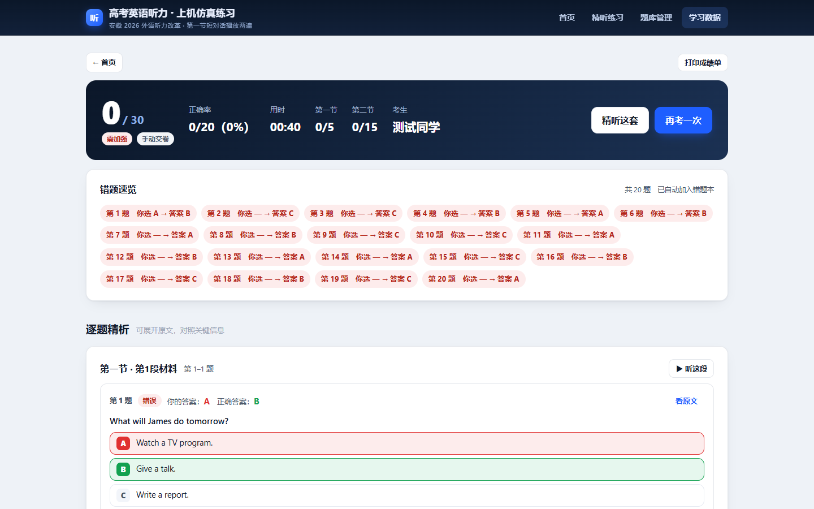
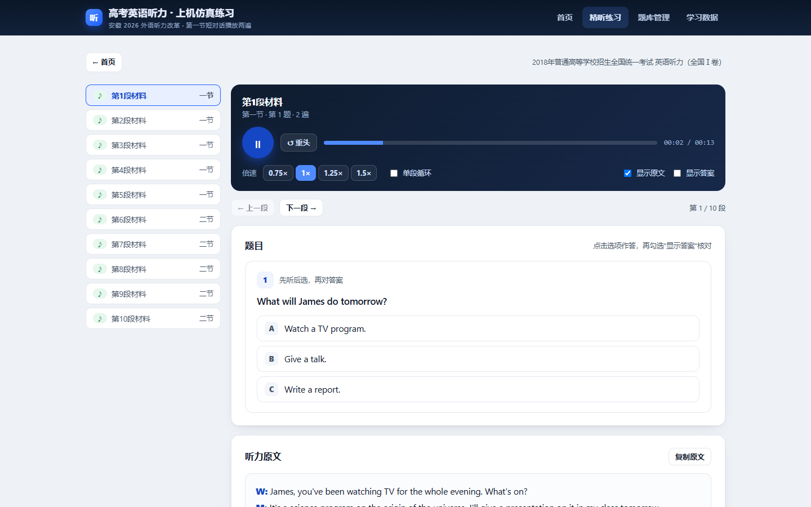
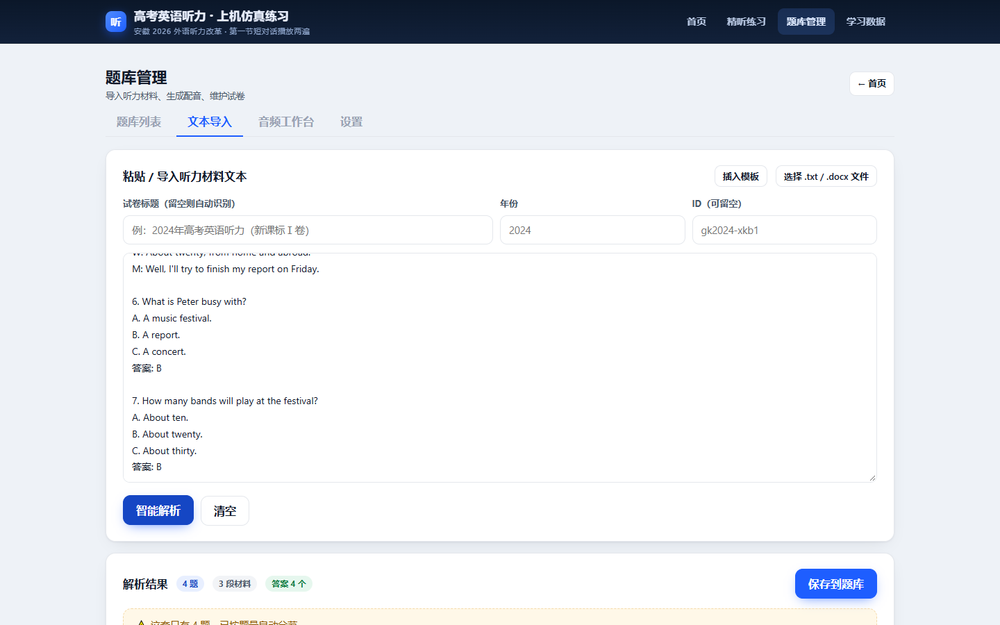
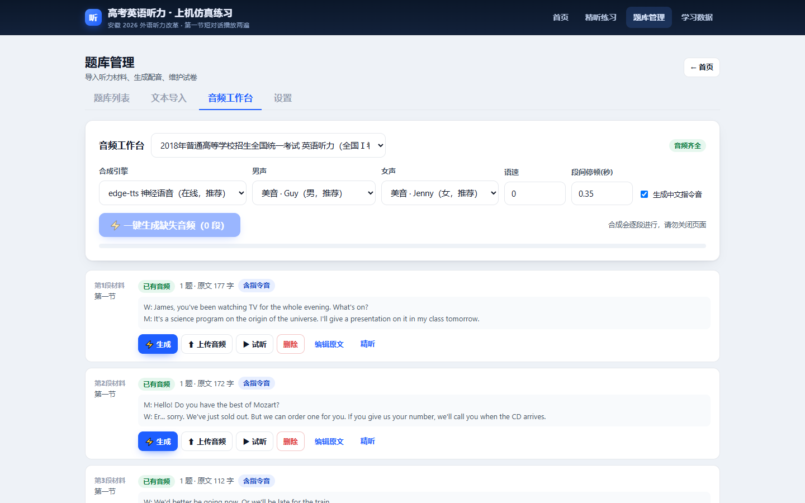

# 高考英语听力机考仿真练习系统 · 使用手册

> 一个装在自己电脑上的听力练习软件：打开就像走进机考考场——试音、阅卷、听音、检查、交卷，一步不落。
> 内置 37 套听力题（17 套高考真题 + 20 套仿真模拟题），全部带音频、答案和听力原文。

---

## 一、它能帮你做什么

| 你想做的事 | 用这个功能 |
|---|---|
| 完整模拟一场机考，找考试感觉 | **全真模考**（试音 → 阅卷 → 听音 → 检查 → 成绩） |
| 某一段没听清，反复磨耳朵 | **精听练习**（倍速、循环、原文、答案） |
| 用听力书 / 老师发的材料练 | **题库管理 → 文本导入**（粘贴或 .txt/.docx） |
| 手里只有文字没有录音 | **音频工作台**（一键用语音合成生成男女声对话） |
| 看自己进步、整理错题 | **学习数据**（成绩曲线、错题本） |

听力材料按 2026 年改革后的题型准备：20 小题、30 分，第一节 5 段短对话、第二节 5 段长对话或独白，**每段都读两遍**。

---

## 二、第一次使用（3 分钟搞定）

1. 安装 [Node.js](https://nodejs.org/zh-cn)（LTS 版即可，装一次，以后不用管）。
2. 双击文件夹里的 **`启动系统.bat`**。
3. 浏览器会自动打开 `http://127.0.0.1:8765/`，看到上面的首页就成功了。

> 那个黑色的命令行窗口就是"服务器"，**关掉它 = 停止服务**。下次用还是一样双击 bat。
> 想更逼真的音频（真人口音）可以再双击 `安装语音合成.bat`，用于把文字自动配上男女声。

---

## 三、全真模考：完整走一遍考场

### 3.1 选卷

首页题库可以按 **全部 / 真题 / 模拟题** 筛选；点任意试卷卡片上的「全真模考」，也可以选"只考第一节/第二节"。

### 3.2 填考生信息

输入姓名（成绩单上会显示）、准考证号，并选择第一节播放遍数（2026 新规是 2 遍，想练旧卷可以切回 1 遍）。页面右侧会算出本次的**阅卷时间 / 听力时长 / 检查时间 / 预计总时长**。

### 3.3 设备试音

戴好耳机，点 **「高考试音（经典版）」**——就是那句著名的"衬衫的价格为九磅十五便士"；
2026 年起这个例题取消了，可以点 **「高考试音（2026 新版）」** 听新版的中文提示 + 英文试音句。
还能单独「🔔 只听提示音」。两种都听清楚后，勾选"我已在耳机中清晰听到"。

### 3.4 阅卷 2 分钟

开考前给你 **2 分钟**浏览全部 20 道题（题干 + 选项），此时**不能作答**，只用来熟悉话题。
题头有醒目的「剩余 120 秒」倒计时，等不及可以点「立即开始听力」。

### 3.5 听音作答

- **每一遍录音开始前**都会响一声「叮咚」提示音，然后才是正文；每段读两遍，两遍前各响一次。
- **听前读题 5 秒/题**：第一节每段 5 秒，第二节 2–4 题给 10–20 秒，播放条会显示"请阅读第 6–7 题… 剩余 X 秒"。
- **只看本段**：屏幕上只显示当前这段材料的题，其他题不可见，也不能跳转；本段结束、下一段开始会自动跳过去。
- **每段结束 5 秒作答**：播放条显示"作答时间 剩余 5 秒"，抓紧点答案。
- **没有进度条**：播放条是一排跳动的波浪，只表示"正在播放"，不给你"还剩几秒"的提示，逼你专注听。

### 3.6 检查 2 分钟

录音播完自动进入**检查修改**阶段：所有题目一次性列出，可以改任意答案，也可以点右侧答题卡跳转。
题头「剩余 120 秒」归零就**自动收卷**，不想等可以直接点「交卷」。

### 3.7 成绩单

交卷后立刻出成绩：分数、正确率、分节得分、用时、离开页面次数，下面是**逐题精析**——每道题显示你选了什么、正确答案是什么，还能点「看原文」展开这段听力原文。

---

## 四、精听练习：把没听清的段落磨透

- 逐段播放、倍速（0.75×–1.5×）、单段循环、拖动定位
- 「显示原文」开关：先盲听，听完再看
- 「显示答案」开关：做题后核对
- 想对照某一句？点「复制原文」粘到别处做笔记

---

## 五、题库管理：内置 37 套，也能放自己的材料

首页点「题库管理」进入，四个标签页：

**题库列表**：37 套（17 真题 + 20 模拟），能看到音频是否齐全，支持搜索、重命名、导出备份、删除。

**文本导入**：把听力书的文字粘贴进来，或直接拖 `.txt` / `.docx`；点「智能解析」，系统自动切出"节—材料—题目—选项—答案—原文"，识别不准还能在 JSON 里手动改。

**音频工作台**：每段材料可以「⚡ 生成」（用原文自动配音，男女声分角色）、「⬆ 上传音频」（用听力书配套 MP3，音质最好），也能批量补齐；勾上"生成中文指令音"后，每段开头还有"听下面一段对话，回答第 6 至第 7 小题"的提示语音。

**设置**：字号、默认播放遍数、**阅卷时间 / 检查时间 / 每段作答时间**、提示音开关。

---

## 六、学习数据：看见进步

- 成绩曲线：最近 20 次模考的柱状图，绿=优秀、蓝=正常、橙=待加强
- 练习记录：每一场的分数、正确率、用时，点「报告」回看逐题解析
- **错题本**：答错的题自动收进来，记录错了多少次，一键跳到对应材料精听

---

## 七、常见问题

**Q：双击 bat 提示"未检测到 Node.js"？**
到 nodejs.org 装 LTS 版，装完重新双击。

**Q：能听到声音但没有"叮咚"？**
在「题库管理 → 设置」里看提示音是否被关掉；也可以在试音页点「🔔 只听提示音」确认。

**Q：某套题没有音频？**
到「音频工作台」点「一键生成缺失音频」，或上传自己手里的 MP3。

**Q：手机上能练吗？**
可以。命令行窗口会打印一个 `http://192.168.x.x:8765/` 的局域网地址，手机连同一 WiFi 打开即可。

**Q：数据存在哪？怎么备份？**
都在这个文件夹里：题库 `data/sets/`、音频 `data/audio/`、成绩 `data/records.json`。
直接复制整个 `gk-listening` 文件夹到别的电脑（装好 Node.js）就能继续用。

**Q：第一节到底播几遍？**
2026 年起第一节短对话播两遍（以前是一遍），系统默认 2 遍；在考生信息页可以切回 1 遍练旧卷。

---

## 八、练得更有效的几个建议

1. **一周 3 套模考**，模拟真实节奏；错题当天用精听回炉。
2. 第一节的 5 秒读题时间别浪费：快速圈出每个选项的差异点。
3. 第二节先扫题干里的疑问词（what/why/how much），带着问题听。
4. 精听时把"没听懂的那一句"用 0.75× 反复听三遍再看原文，比直接看原文有效。
5. 成绩单上的"逐题原文"是宝藏，睡前读一遍，第二天再听一遍同段。

---

## 九、小档案

- 版本：1.0
- 题库：37 套（真题 2018–2026 共 17 套 + 按 2026 题型编写的仿真模拟题 20 套）
- 音频：740 个 MP3（每段材料 + 中文指令音），约 85 MB
- 数据：全部保存在本机，不上传云端
- 语音合成：edge-tts（在线神经语音）/ Windows 本地语音（离线备用）

> 说明：题库文字来自公开的高考真题资料与原创编写，音频由语音合成生成（非官方录音），仅供个人学习使用。
